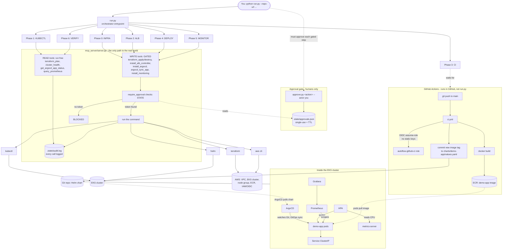

# Code Flow — Automated DevOps Flow (end to end)

How the pieces connect, from `python run.py` down to AWS and into the cluster.
GitHub renders the Mermaid diagram below.

---

## Read it in words

1. **`run.py`** is the single entrypoint. It drives 7 phases in order
   (Infra → Kubectl → ALB → CI → Deploy → Monitor → Verify).

2. **Approval gate (humans only).** A human runs `approve.py <action>`, which
   writes a single-use, TTL'd token to `.state/approvals.json`. Agents cannot
   create approvals.

3. **MCP server = the only path to the real world.** Every phase calls MCP
   tools, never raw shell:
   - **READ** tools (plan/health/status/query) run freely.
   - **WRITE** tools call `require_approval()` → token found = run, no token =
     BLOCKED. Everything is logged to `.state/audit.log`.

4. **Execution layer.** Approved tools shell out to `terraform` / `kubectl` /
   `helm` / `aws`, which act on AWS and the cluster.

5. **CI runs in GitHub (not run.py).** A push triggers `ci.yml` → OIDC
   assume-role (no static keys) → build + push image to ECR → commit the new
   image tag back to the Helm chart in Git. Phase 3 just waits for this.

6. **Inside the cluster.** ArgoCD watches Git and GitOps-syncs the chart →
   `demo-app` pods (pulling the image from ECR) → Service → HPA autoscales
   using metrics-server → Prometheus scrapes, Grafana visualizes.

### The two connections that make GitOps click
- **Git → ArgoCD:** ArgoCD deploys whatever the chart in Git says — and CI
  updated that chart. (the GitOps handoff)
- **ECR → pods:** the image CI pushed is exactly what the pods run.

Full loop: **push code → CI builds & updates Git → ArgoCD deploys from Git →
pods run the ECR image → HPA/Prometheus manage it** — all on infra Terraform
built through the approval-gated MCP tools.
